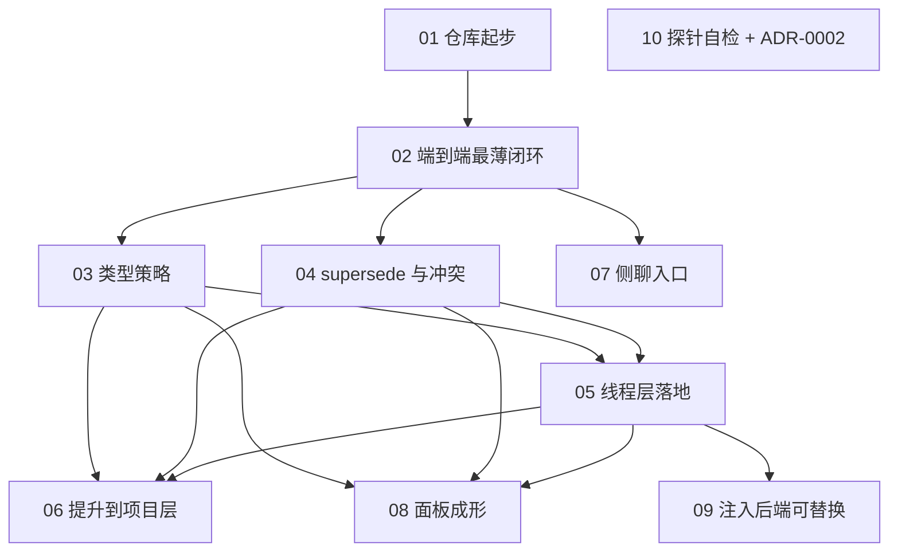

# align — 工单依赖图

这是一张**视图**，不是事实来源。事实来源是 `.scratch/align/issues/*.md` 里每张票的 `Blocked by:` 行；改动依赖请改票，然后回来同步这张图。

一条边 `A → B` 读作"B 被 A 阻塞"。

## 同一张图的表格

| # | 工单 | 阻塞于 | 备注 |
| --- | --- | --- | --- |
| 01 | 仓库起步 | — | 无 git 就没有分支和 worktree，是真前置 |
| 02 | 端到端最薄闭环 | 01 | 建立骨架与 `logic/` 的形状 |
| 03 | 类型策略 | 02 | 类型 → 行为走配置，不走代码分支 |
| 04 | supersede 与冲突 | 02 | 追加式，旧条目标失效不删除 |
| 05 | 线程层落地 | 02, 03 | 走 `ui/update-model-context`，一次性附着 |
| 06 | 提升到项目层 | 03, 04, 05 | 线程层脆弱性的唯一出口 |
| 07 | 侧聊入口 | 02 | 隔离上下文追问，不污染主线 |
| 08 | 面板成形 | 03, 04, 05 | ~371px 宽，纯内联 |
| 09 | 注入后端可替换 | 05 | 压缩对线程层的影响尚未实测 |
| 10 | 探针自检 + ADR-0002 | — | 与主线无依赖，随时可并行 |

## 前沿

随时可抓：**04**、**07**、**10**。（01、02、03 已 resolved；04/07 的阻塞边指向的 02 已经落地。）
