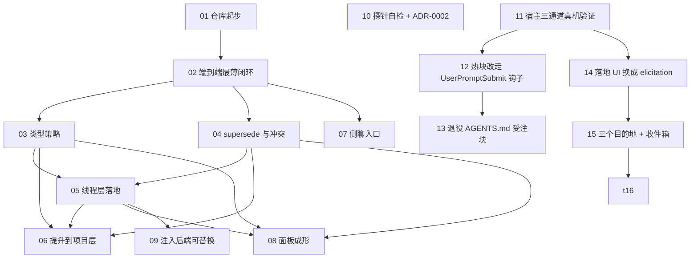

# align — 工单依赖图

这是一张**视图**，不是事实来源。事实来源是 `.scratch/align/issues/*.md` 里每张票的 `Blocked by:` 行；改动依赖请改票，然后回来同步这张图。

一条边 `A → B` 读作"B 被 A 阻塞"。

## 同一张图的表格

| # | 工单 | 阻塞于 | 备注 |
| --- | --- | --- | --- |
| 01 | 仓库起步 | — | 无 git 就没有分支和 worktree，是真前置 |
| 02 | 端到端最薄闭环 | 01 | 建立骨架与 `logic/` 的形状 |
| 03 | 类型策略 | 02 | 类型 → 行为走配置，不走代码分支 |
| 04 | supersede 与冲突 | 02 | **已 resolved（0.2.7）**：候选断言带 `supersedes`，仍走原生表单确认；旧条目标 `superseded by <新 id>`。「同一主题提示」降级为不做 |
| 05 | 线程层落地 | 02, 03 | **wontfix**（2026-10-05）：一次性附着满足不了"每轮"，改走钩子 |
| 06 | 提升到项目层 | 03, 04, 05 | **wontfix**：依赖 05，没有对象了 |
| 07 | 侧聊入口 | 02 | 隔离上下文追问，不污染主线 |
| 08 | 面板成形 | 03、04、05 | **已实现（0.2.8），待真机复验**：改成"查看与编辑账本"，不落地；改标签原地改、改措辞走取代、退休用新增的 `retired`。~371px 宽，纯内联 |
| 09 | 注入后端可替换 | 05 | **wontfix**：它要解的压缩悬念随线程层一起消失 |
| 10 | 探针自检 + ADR-0002 | — | 与主线无依赖，随时可并行 |
| 11 | 宿主三通道真机验证 | — | **已 resolved**：三条都问出了答案，而且都改了做法（钩子载体、原生表单、侧聊可用） |
| 12 | 热块改走 UserPromptSubmit 钩子 | 11 | 11 的结论：热块不是每轮重读；钩子是新的候选载体 |
| 13 | 退役 AGENTS.md 受注块 | 12 | 钩子已端到端验成；受注块变成重复且会过期的负担 |
| 14 | 落地 UI 换成 elicitation | 11 | **已 resolved**：原生表单替代"口述让 Agent 调工具"；主线程与侧聊同一张表。AC3（整张取消）按早返回覆盖，未单独真机走 |
| 15 | 三个目的地 + 收件箱 | 14 | 表单只选"去哪"；类型退化成标签；复述走收件箱一次性投递。**已 resolved（真机全过 2026-10-06）** |
| 16 | 手动入口 align-now | 15 | 技能而不是 `/` 命令（宿主不给插件注册命令）；`/` →「技能」→ align-now → 回车即弹表单。**已 resolved（真机全过 2026-10-06）** |

## 前沿

**只剩两张**：**08** 待真机复验（渲染与美化），**10** 没动过（探针 + ADR-0002 换题目）。（01、02、03、04、11、12、13、14、15、16 已 resolved；05、06、09 已 wontfix。）
